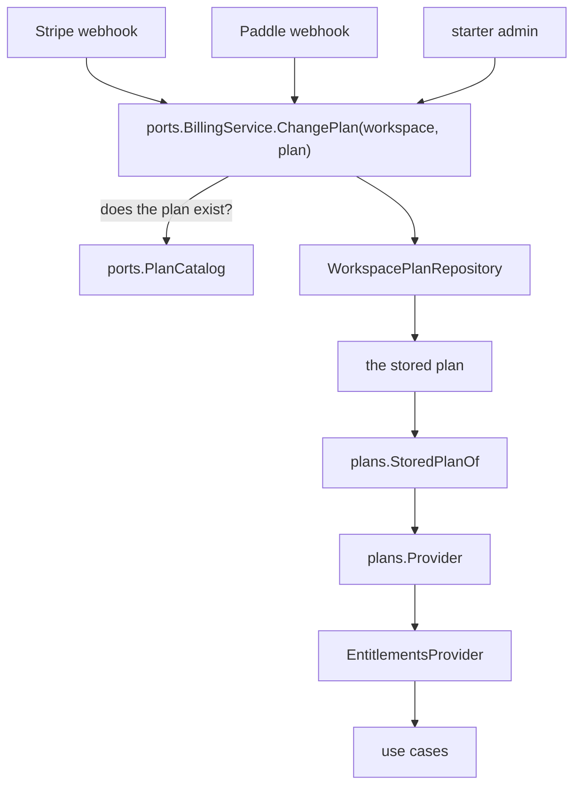

# Billing: connecting plans to payments

This guide explains how a product built from this template gets paid. It covers the concepts, running paid accounts by hand, connecting Stripe, merchant-of-record providers, downgrades, and failed payments, and a paid local licence. The decision behind it is [ADR 5](adr/0005-hosted-and-local-editions.md), "Billing is a driving adapter". The business rules are in `SPEC.md` §4.15, "Change a workspace's plan".

## What exists today

**The template doesn't take payments.** It ships the one step that billing comes down to, moving a workspace to a plan, and an admin command that runs it.

- **Built:** `ChangePlan`, each storage adapter's stored plans, `plans.StoredPlanOf`, and `starter admin set-plan`, all proved by the acceptance tests.
- **Built:** the hosted edition, with sign-in through an OIDC provider or the dev sign-in ([docs/sign-in.md](sign-in.md)). With the `sign_in` setting on, each workspace is on its stored plan, and `starter admin set-plan` changes it.

With sign-in off, every copy is the local edition. Then `bootstrap.NewBilling` refuses, and `starter admin set-plan` fails with "The plan for the local edition is set when the application is built and cannot be changed." [Stored plans are switched on](#stored-plans-are-switched-on-with-sign-in) explains the difference.

## The concepts



- **A plan is a name in the plans file** (`internal/adapters/plans/plans.jsonc`). It sets a workspace's limits and features. It knows nothing about prices. `docs/features.md` covers features, and `.claude/rules/workspaces-and-plans.md` covers limits.
- **`ChangePlan(ctx, workspace, plan)` is the core's only billing concept.** The core has no idea of money, invoices, or subscriptions. Those live in the payment provider, and the provider's adapter translates them into a call to `ChangePlan`.
- **A payment provider is a driving adapter.** It calls the core through a driving port, as a REST handler does. It goes in its own package under `internal/adapters`, and `internal/bootstrap` wires it.
- **The workspace is an argument.** Everywhere else, a use case asks `ports.WorkspaceResolver` for the current workspace. `ChangePlan` is the exception, because an admin or a webhook acts on someone else's workspace, with no signed-in user behind the request. So the caller must get the workspace from somewhere it can trust (see [Which workspace paid?](#which-workspace-paid)).

`ChangePlan` has these rules:

| Given | It |
|---|---|
| A plan in the plans file | saves it, replacing the workspace's plan |
| A plan the file doesn't have | returns a `*domain.ValidationError` on `plan`, and saves nothing |
| A plans lookup that fails | returns the error, and saves nothing |
| An empty workspace | returns `domain.ErrNoWorkspace`, before touching anything |
| A workspace now over a limit | saves it anyway: see [Downgrades](#downgrades-and-failed-payments) |

Saving the same plan twice changes nothing, so calling `ChangePlan` again is always safe.

A workspace with no stored plan is on the default plan given to `plans.StoredPlanOf`. If the read fails for any other reason, the error is passed on, and the workspace never falls back to the default.

**Keep plan names once they're in use.** Stored plans refer to the plans file by name. If you rename or remove a plan, a workspace still stored on it can't get its entitlements, and everything its plan gates is refused until you move that workspace. Move those workspaces first.

## Stored plans are switched on with sign-in

A workspace's stored plan counts only in the hosted edition, which is a server with the `sign_in` setting on. The local edition keeps its fixed plan, so a local user can't upgrade their own copy by editing stored data. `internal/bootstrap` makes the choice in two places:

1. **`bootstrap.NewBilling`** returns the real billing service when sign-in is on. It opens the configured storage, as the server does, and hands back `app.NewBillingService` on that storage's `ports.WorkspacePlanRepository`. With sign-in off, it refuses with `ErrLocalPlanIsFixed`. It always refuses `--server` with `ErrNoPlanChangesOverAServer`, until an admin API exists.
2. **The hosted edition's `plans.Provider`** reads each workspace's plan with `plans.StoredPlanOf`. A workspace with no stored plan, such as a new account's workspace, is on the plans file's `newWorkspacePlan`. The provider also gives hints, so locked features name the plans that have them.

The plans file names the starting plan in its top-level `newWorkspacePlan` field, which must be one of its plans:

```jsonc
{
  "newWorkspacePlan": "free",
  "plans": { ... }
}
```

[docs/features.md](features.md) describes the rest of the plans file.

## Running paid accounts by hand

You don't need a payment provider to start charging. Send an invoice, and when it's paid, on a computer with access to the hosted edition's storage, run the command with the server's storage and sign-in settings:

```sh
STARTER_STORAGE=postgres STARTER_DATABASE_URL=postgres://… STARTER_SIGN_IN=dev \
  starter admin set-plan WORKSPACE pro
```

`WORKSPACE` is the workspace's ID. Each account's personal workspace is in the `workspace_id` column of the `accounts` table. Give `set-plan` the same sign-in setting as the server. With `STARTER_SIGN_IN=oidc`, `set-plan` also needs the server's four other sign-in settings (`docs/configuration.md`), and it reaches the sign-in provider when it starts, as the server does, because it builds the same hosted edition. `STARTER_SIGN_IN=dev` works only in a program built with the `devsignin` build tag, such as `task run:cli`.

It prints `Workspace WORKSPACE is now on the pro plan.` To end a paid account, run it again with your free plan.

- **It's not a network API.** The command works on the storage directly, so being able to run it means having access to the storage. It refuses `--server`. An admin API waits for roles, which come with teams.
- **It takes effect straight away in the core.** The web app keeps the entitlements it read for the session, so someone already using it sees the new plan after reloading. Until then the core still applies the new plan.
- **It suits a handful of customers,** such as annual contracts or a closed beta. Beyond that, connect a provider.

## Stripe

This walkthrough connects Stripe subscriptions: customers pay on Stripe's checkout page, Stripe tells your server what happened by webhook, and the webhook moves the workspace to its plan. Check the code against [Stripe's webhook docs](https://docs.stripe.com/webhooks) and [subscription webhook docs](https://docs.stripe.com/billing/subscriptions/webhooks) as you go, because the APIs change.

### 1. Set up products and prices

In Stripe, create a product for each paid plan and a price for each way of paying for it (monthly, yearly). Then map each price ID to a plan name, in a setting (`docs/configuration.md`):

```
price_1Pro…Monthly → pro
price_1Pro…Yearly  → pro
```

Several prices can lead to one plan. A price with no plan is a mistake in your setup, so check the map at start: every plan it names must be in the plans file.

Keep the API key and the webhook signing secret out of the settings file: use environment variables such as `STARTER_STRIPE_API_KEY`, and your host's secrets store.

### 2. Start a checkout

When someone chooses a plan, the web app asks your server to start a checkout, and sends them to the URL it returns. This is a normal API feature: a new endpoint in `api/openapi.yaml`, a driving port, and a use case that calls a driven port wrapping Stripe's Checkout Sessions API. Create the session with:

- `mode: subscription`, with the chosen price;
- `client_reference_id` set to the workspace;
- `subscription_data.metadata.workspace_id` set to the workspace, so that every later event about the subscription says which workspace it belongs to;
- `success_url` and `cancel_url`, your pages to come back to.

#### Which workspace paid?

**The use case takes the workspace from `ports.WorkspaceResolver`, never from the request.** If the browser could name it, anyone could pay for someone else's workspace or read their billing details.

**The return to `success_url` proves nothing.** Anyone can open that page. Only a verified webhook changes a plan, so the page should say "thanks, we're setting up your plan" and refetch the entitlements.

### 3. Receive the webhook

Add a package such as `internal/adapters/stripewebhook`, holding an `http.Handler` that takes a `ports.BillingService`. Pass the handler in through `httpapi.Options`, and mount it in `internal/adapters/httpapi/server.go`, beside `/healthz`:

```go
mux.Handle("POST /webhooks/stripe", opts.StripeWebhook)
```

The route isn't part of `api/openapi.yaml`, because your front ends never call it. Add it to `navigateFallbackDenylist` in `web/vite.config.ts`, as for any server route outside `/api`. In `internal/bootstrap`, wire it only for the hosted edition.

A sketch of the handler, leaving out the logging:

```go
func (h *Handler) ServeHTTP(w http.ResponseWriter, r *http.Request) {
	body, err := io.ReadAll(http.MaxBytesReader(w, r.Body, 65536))
	if err != nil {
		w.WriteHeader(http.StatusBadRequest)
		return
	}
	// The raw body and the header prove that Stripe sent this. Always first.
	event, err := webhook.ConstructEvent(body, r.Header.Get("Stripe-Signature"), h.signingSecret)
	if err != nil {
		w.WriteHeader(http.StatusBadRequest)
		return
	}
	switch event.Type {
	case "customer.subscription.created", "customer.subscription.updated", "customer.subscription.deleted":
	default:
		w.WriteHeader(http.StatusOK) // Nothing to do: don't let Stripe retry it.
		return
	}
	var sent struct {
		ID string `json:"id"`
	}
	if err := json.Unmarshal(event.Data.Raw, &sent); err != nil {
		w.WriteHeader(http.StatusBadRequest)
		return
	}
	// Events can arrive in any order, so ask Stripe where things stand now.
	subscription, err := h.subscriptions.Get(r.Context(), sent.ID)
	if err != nil {
		w.WriteHeader(http.StatusInternalServerError) // Stripe will retry.
		return
	}
	workspace := subscription.Metadata["workspace_id"]
	if workspace == "" {
		w.WriteHeader(http.StatusOK) // Not one of ours, and a retry won't help.
		return
	}
	plan, shouldChange := h.planFor(subscription)
	if !shouldChange {
		w.WriteHeader(http.StatusOK)
		return
	}
	if err := h.billing.ChangePlan(r.Context(), domain.WorkspaceID(workspace), plan); err != nil {
		w.WriteHeader(http.StatusInternalServerError) // Stripe will retry.
		return
	}
	w.WriteHeader(http.StatusOK)
}
```

`webhook.ConstructEvent` comes from [stripe-go](https://github.com/stripe/stripe-go), and `h.subscriptions` is a small interface over its subscriptions client, so that tests can fake it.

When you create the webhook endpoint in Stripe, choose **snapshot** events, the payload format this guide uses, and subscribe to the three events above. Stripe offers **thin** events too, and suggests them for new integrations. Check that [their catalog](https://docs.stripe.com/api/v2/core/events/event-types) covers what you need before choosing them. Because this handler reads the subscription from Stripe anyway, little else would change.

Subscribe to `invoice.payment_failed` too if you want to email customers yourself. It doesn't change a plan (see [Downgrades](#downgrades-and-failed-payments)).

### 4. Decide the plan from the subscription

`planFor` looks only at the subscription's current status and price:

| Status | Plan |
|---|---|
| `active`, `trialing` | the plan mapped from the subscription's price |
| `past_due` | the same: payment failed, and this is your grace period |
| `incomplete` | no change: the first payment hasn't finished |
| `canceled`, `unpaid`, `incomplete_expired`, `paused` | your free plan |

Stripe sends `customer.subscription.deleted` when a subscription ends, with the status `canceled`, so one table covers all three events.

This handler assumes one subscription per workspace. Send customers to the [Customer Portal](https://docs.stripe.com/customer-management) to switch plans or cancel, which changes that one subscription. A second subscription could otherwise overwrite the first one's plan. The portal needs the Stripe customer ID, so keep it for each workspace in a small repository like `ports.WorkspacePlanRepository`, written when the checkout completes.

### Duplicates, ordering, and failures

- **Duplicate deliveries:** Stripe may deliver an event more than once. `ChangePlan` gives the same result each time, so you don't need to record event IDs. Record them only if you add something that mustn't happen twice, such as a welcome email.
- **Ordering:** Stripe doesn't guarantee the order of events, and its `created` timestamp can't sort them. That's why the handler reads the subscription from Stripe instead of trusting the event's copy: a late event then sets the current state, not an old one.
- **Failures:** anything other than a `2xx` makes Stripe retry, for up to three days in live mode and three times in a sandbox. Return an error when a retry could help (storage is down, or a plan is missing from the plans file), and `200` when it can't.
- **Speed:** Stripe wants a quick `2xx`. One read and one small write is fine at first. If renewals bunch up, put events on a queue and answer straight away.
- **Refunds and disputes:** these don't change a plan on their own. If you decide to end someone's access, cancel the subscription in Stripe, and the normal path moves the workspace. Every plan change then comes from the subscription's state.

### Test it locally

Install the [Stripe CLI](https://docs.stripe.com/cli/install), then, with the server running:

```sh
stripe login
stripe listen --forward-to localhost:8080/webhooks/stripe
```

`stripe listen` prints a signing secret (`whsec_…`). Give that to your server while testing, because it differs from the real endpoint's.

- **A whole purchase:** go through your checkout in a sandbox, with Stripe's [test cards](https://docs.stripe.com/testing), so that the metadata is real. This is the test that matters.
- **Single events:** `stripe trigger customer.subscription.updated` sends one, but its fixture has no `workspace_id`, so your handler will ignore it. Use `--add` or `--edit` to put the metadata in (`stripe trigger --help`).
- **A duplicate:** `stripe events resend <event_id>` sends an event again.

Also write ordinary tests: `stripe-go` can sign a test payload (`webhook.GenerateTestSignedPayload`), so a test can post a signed event to the handler with a fake `BillingService`. Test a bad signature above all: it must change nothing. To add a scenario in `features/`, keep it in business language, as `features/plan-changes.feature` does.

### Before going live

- [ ] The webhook endpoint is HTTPS, registered in live mode, and uses the live signing secret.
- [ ] The signature is checked before anything else, on the raw body.
- [ ] Nothing but a verified webhook or an admin changes a plan.
- [ ] The workspace in the checkout comes from `ports.WorkspaceResolver`.
- [ ] The price map uses live price IDs, and every plan it names is in the plans file.
- [ ] Stripe's failed-payment setting says what happens when retries run out (see below).
- [ ] You've handled tax: Stripe is not the seller of record, so registering and filing are yours. [Stripe Tax](https://docs.stripe.com/tax) can calculate it.

## Merchant-of-record providers

With Stripe you are the seller, so sales tax, VAT, and invoicing rules in each customer's country are yours to handle. A **merchant of record** such as [Paddle](https://developer.paddle.com) or [Lemon Squeezy](https://docs.lemonsqueezy.com) is the legal seller instead, and takes on that tax work for a higher fee. Check their current pricing and whether they accept your kind of product. For a small team selling worldwide, the higher fee is often worth it.

The adapter has the same shape as Stripe's. Only the names change:

| | Stripe | Paddle | Lemon Squeezy |
|---|---|---|---|
| Signature header | `Stripe-Signature` | `Paddle-Signature` | `X-Signature` |
| Checked with | HMAC-SHA256 over the timestamp and raw body | HMAC-SHA256 over the timestamp and raw body | HMAC-SHA256 over the raw body |
| Subscription events | `customer.subscription.*` | `subscription.*` | `subscription_*` (`subscription_updated`, `subscription_expired`, …) |
| Carries your workspace ID in | `metadata` | `custom_data` | custom checkout data |

Whichever you use, keep the same rules: verify the signature on the raw body first, take the workspace from what you set at checkout, read the current state rather than trusting event order, map the provider's price to your plan, and call `ChangePlan`. Check each provider's docs for its statuses and retries. If you might change provider, keep the decision table in one function, so that only the adapter changes.

## Downgrades and failed payments

**A smaller plan never deletes data.** `ChangePlan` checks no limits. The workspace keeps everything, and the plans file says what happens to whatever is over a limit (`SPEC.md` §4.9):

- `block-new` keeps the data and refuses new records;
- `read-only` also refuses changes to the records of that kind;
- deleting always works, so a workspace can get back within a limit;
- a feature the new plan doesn't have is off straight away, and shows as locked or hidden, as its `whenOff` says.

**When to downgrade:**

- **Cancelling:** let the customer keep what they've paid for. Stripe's cancel-at-period-end leaves the subscription `active` until the period ends, then ends it, so the table in step 4 already does the right thing.
- **Failed payments:** a failed payment isn't the end of a subscription. Stripe retries, and the subscription is `past_due` in the meantime. That's your grace period: the workspace keeps its plan, and you ask the customer to update their card.
- **Giving up:** in Stripe's [subscription settings](https://dashboard.stripe.com/settings/billing/subscriptions#manage-failed-payments), choose what happens when retries run out. Pick `canceled` or `unpaid`, which both end in your free plan. If you leave it as `past_due`, the workspace keeps its paid plan for ever.

There's no grace timer in the core, because the provider's retry schedule is one already. If you want a longer one, set it in the provider.

**Tell people first.** A customer who finds their workspace read-only with no warning writes to support. Send an email when a payment fails (`invoice.payment_failed`) and when a downgrade happens. A front end can also say which limit they're over, from the entitlements.

## A paid local licence

The local edition has no accounts and no server, so `ChangePlan` isn't how it gets paid. Its plan is `bootstrap.LocalPlan`, fixed when the app is built.

**Today:** sell a separate build, with a different plan:

```sh
go build -ldflags "-X <module>/internal/bootstrap.LocalPlan=local-pro" ./cmd/starter
```

**Later, an offline signed key.** This isn't in the template (it's a follow-up in `TODO.md`), but the seam for it is there, because `plans.Provider.PlanOf` is a function:

1. When someone buys a licence, your server signs a small document (plan name, customer, expiry) with a private key, such as Ed25519. The buyer gets the result as a key.
2. The app embeds the public key. It reads the licence from the data folder, and checks the signature with no network.
3. In `localEntitlementsProvider`, `PlanOf` answers the licence's plan when the licence is valid, and `LocalPlan` otherwise.

Keep two things in mind. Anyone who can change the binary can remove the check, so a key keeps honest people honest and no more. And a bad or expired licence should leave the app on `LocalPlan`, still working on the user's data, never locked out of it.

## Checklist for connecting a provider

- [ ] The hosted edition's stored plans are switched on, and the local edition's plan stays fixed.
- [ ] The adapter is a driving adapter in its own package, calling `ports.BillingService`, wired in `internal/bootstrap`.
- [ ] The signature is verified before anything else, and a test proves a bad one changes nothing.
- [ ] The workspace comes from the checkout, set from `ports.WorkspaceResolver`.
- [ ] Duplicate and out-of-order events end in the right plan.
- [ ] Every status maps to a plan or to "no change".
- [ ] Prices map to plans in the plans file, checked at start.
- [ ] The failed-payment path ends in a downgrade, and customers are told.
- [ ] The new server route is in `navigateFallbackDenylist`.
