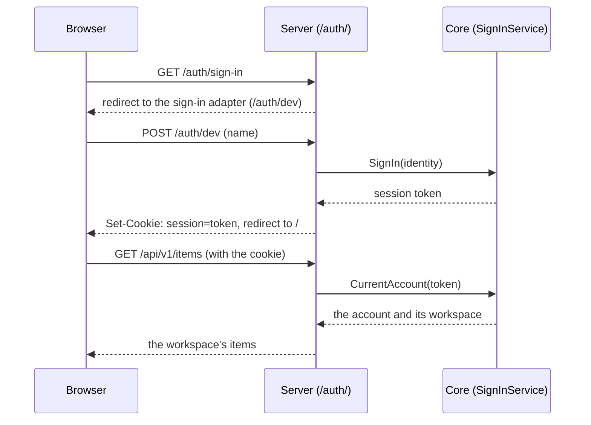

# Sign-in: accounts and sessions in the hosted edition

This guide explains how people sign in to the hosted edition, and how to try it with the dev sign-in. The decision behind it is [ADR 9](adr/0009-sign-in-and-sessions.md), and the editions themselves are [ADR 5](adr/0005-hosted-and-local-editions.md). The business rules are in `SPEC.md` §4.18, "Sign in to the hosted edition".

**What exists today:** everything sign-in needs, proved with the **dev sign-in**, a stand-in that signs in whoever types a name. A real sign-in provider, through [OpenID Connect (OIDC)](https://openid.net/developers/how-connect-works/), is step 8b of [`docs/plans/editions-and-accounts.md`](plans/editions-and-accounts.md). It will plug in behind the same seam, so nothing else in this guide changes when it arrives.

## When sign-in is on

Sign-in is a server setting, `sign_in` (`STARTER_SIGN_IN`), and it is `off` by default.

- **With it off,** the server is the local edition, for one person hosting it for themselves. There is one workspace and no sign-in, and the web app shows no sign-in or sign-out.
- **With it on** (`dev` today, and `oidc` in step 8b), the server is the hosted edition. Each person signs in to their own account, and works in that account's personal workspace.

The desktop and mobile apps, and the command line and the terminal app on their own data, are always the local edition. [docs/configuration.md](configuration.md) has the setting's full rules.

Sign-in keeps accounts and sessions in the app's storage, so it needs `memory`, `sqlite`, or `postgres` storage. Plain-text storage (`jsonfile`) is only for the local edition, so a program with sign-in on refuses it at start:

```
The sign-in setting is "dev", but the storage setting is "jsonfile". Sign-in needs "memory", "sqlite", or "postgres" storage. Please change the storage setting, or set the sign-in setting to "off".
```

## How it works



1. **A sign-in adapter finds out who someone is.** It turns that into a `domain.Identity`, with three parts. The issuer is who vouches for the person. The subject is the issuer's ID for them, which never changes. The name is what the app shows. The dev sign-in uses the issuer `dev`, and the typed name as both the subject and the name.
2. **The adapter calls the core's `ports.SignInService.SignIn`.** The first time an identity signs in, the core creates an account for it and a personal workspace. Later sign-ins find the same account by its issuer and subject, never by its name, because a name can change and two people can share one. The core returns a new session token.
3. **The server puts the token in a cookie** named `session`. The browser sends it back with every request. The web app never sees the token.
4. **The session middleware** looks the token up on every request (`CurrentAccount`), and puts the account's workspace in the request's context (`workspace.WithID`). The use cases then work in that workspace, as [docs/workspaces.md](workspaces.md) explains.
5. **Signing out** (`POST /auth/sign-out`) deletes the session from storage and clears the cookie.

### Signed out means no workspace

A request with no cookie, or with a cookie whose session is unknown or expired, runs with no workspace. Every use case already refuses a request with no workspace, with `domain.ErrNoWorkspace`, before it touches storage. Over HTTP, that is a 401 problem:

```json
{"type": "no_workspace", "title": "Unauthorized", "status": 401, "detail": "Please sign in to continue."}
```

So a handler needs no sign-in check of its own. If you add a route and forget about sign-in, it still shows no data to someone signed out. This is called "failing closed".

## Sessions

- **The token** is 32 random bytes from `crypto/rand` (`system.Tokens`, behind `ports.TokenGenerator`).
- **Storage keeps only the token's SHA-256 hash,** never the token. A hash can't be turned back into the token. So someone who gets a copy of the database still can't use any session in it.
- **A session lasts 30 days** from signing in (`domain.SessionLifetime`), and isn't renewed by use. An expired session counts as missing, and is deleted when someone tries to use it. Expired sessions that nobody tries to use stay in storage for now. Sweeping them away is a follow-up in the editions plan.
- **Sessions are kept in the app's storage,** beside the data. So every copy of the server on one database knows every session, and signing out ends a session everywhere at once.

### The cookie

The cookie has these attributes. Each one is a browser feature that limits what can go wrong:

| Attribute | What it does |
|---|---|
| `HttpOnly` | Page scripts can't read the cookie. A script injected into the page, which is called cross-site scripting (XSS), can't steal the session. |
| `SameSite=Lax` | The browser leaves the cookie off most requests that other sites start, such as a form on another site that posts to this one. It still sends the cookie when someone follows a link to the app. |
| `Secure`, over HTTPS | The browser only sends the cookie over an encrypted connection. |
| `Max-Age`, the session's 30 days | The cookie outlives the browser being closed, as long as the session does. |
| `Path=/` | The cookie goes with every request to the server, for the API and the `/auth/` routes alike. |

The server decides `Secure` from the connection it receives. Behind a proxy that handles HTTPS for it, the server sees plain HTTP, so the cookie isn't marked `Secure` yet. That is a follow-up in `TODO.md`, to settle before the first hosted deployment.

### Requests from other sites

With sign-in on, the server refuses any request that changes something unless it comes from the server's own pages. A request that changes something is any request except `GET`, `HEAD`, and `OPTIONS`. This protects against cross-site request forgery (CSRF), where another site makes the browser send a request that carries this site's cookie.

Go's [`http.CrossOriginProtection`](https://pkg.go.dev/net/http#CrossOriginProtection) does the check. It reads the `Sec-Fetch-Site` header, which modern browsers send with every request, or, without it, the `Origin` header. A refused request gets a 403 problem of type `cross_site`. Programs that aren't browsers, such as `curl` or the command line, send neither header, so they aren't refused.

`SameSite=Lax` already stops most of these requests. The check closes the cases it misses, such as a page on another origin of the same site. It covers the sign-in form too, which runs before any cookie exists.

## The routes

Sign-in is redirects and HTML forms, not JSON, so its routes live under `/auth/`, beside the API, and not in `api/openapi.yaml`:

| Route | What it does |
|---|---|
| `GET /auth/sign-in` | Redirects to the configured sign-in adapter. The web app's "Sign in" link goes here, so it doesn't need to know which adapter is on. |
| `GET /auth/dev` | The dev sign-in's form, which asks for a name. |
| `POST /auth/dev` | Signs in as the posted name, sets the cookie, and redirects to `/`. A blank name is a 422 `validation` problem. |
| `POST /auth/sign-out` | Ends the session, clears the cookie, and redirects to `/`. |

The web app's service worker leaves `/auth/` alone (`navigateFallbackDenylist` in `web/vite.config.ts`), so these routes always reach the server.

The web app learns its state from `GET /api/v1/session`, which is in the OpenAPI file and always answers 200:

```json
{"isSignInOn": true, "name": "Ada"}
```

Signed out, `name` is left out, and the web app shows a sign-in screen and no data. Signed in, it shows the name and a "Sign out" button. With sign-in off, `isSignInOn` is `false`, and it shows neither.

## The dev sign-in

The dev sign-in lets anyone sign in as anyone, so it must never reach a public server. Its wiring is behind a Go [build tag](https://pkg.go.dev/cmd/go#hdr-Build_constraints), `devsignin`, which leaves code out of a build unless the build asks for it:

- `task dev`, `task run:server`, `task run:cli`, and `task run:tui` build with the tag.
- The browser journey's server builds with it too.
- `task test:go` runs `internal/bootstrap`'s tests a second time with the tag, as the tests that need sign-in on only build with it.
- `task build`, and so every release, builds without it.

A program built without the tag refuses `sign_in = "dev"` at start:

```
The sign-in setting is "dev", but this program was built without the dev sign-in, which is only for development and tests. Please set the sign-in setting to "off", or build the program with the "devsignin" build tag.
```

Building with the tag doesn't turn sign-in on by itself. The `sign_in` setting still decides.

### Trying it

Run the development servers with sign-in on, on memory storage:

```sh
STARTER_SIGN_IN=dev STARTER_STORAGE=memory task dev
```

The web app opens signed out, with a sign-in screen. Follow "Sign in", type a name, and you're in that name's workspace. Sign out, and sign in under another name, to see that the two workspaces are apart. Memory storage forgets everything when the server restarts. Use `STARTER_STORAGE=sqlite` to keep accounts and sessions between restarts.

## How it's tested

- **The core:** `app.SignInService`'s unit tests cover new and returning identities, unknown and expired tokens, and signing out, with the `testsupport` fakes for time, IDs, and tokens.
- **Storage:** `storagetest` has contract suites for `AccountRepository` and `SessionRepository`, which memory, SQLite, and Postgres pass. jsonfile has neither.
- **The server:** `httpapi`'s tests cover the cookie, the `/auth/` routes, the 401 and 403 problems, and the session endpoint.
- **Acceptance:** `features/sign-in.feature` (`@sign-in`) runs on the memory, sqlite, postgres, and http drivers. The http driver signs in through `/auth/dev`, with one cookie jar per account. `features/workspaces.feature` also runs on http, where each workspace is a signed-in account's.
- **The browser:** `web/e2e/features/sign-in.feature` signs in with the dev sign-in and signs out. It runs in its own Playwright project, against its own server with sign-in on, so the other journeys keep a server without it.

## Not built yet

- **A real sign-in provider (step 8b).** An OIDC adapter, behind the same `SignInService` port, tested against a small fake provider inside the tests. Accounts with an email address and a password will come from the provider, not from the product, so the product never stores a password.
- **The command line and terminal app signing in (step 9).** They will send a bearer token in a header instead of a cookie, since they aren't browsers, and the middleware will accept both.
- **Roles,** such as an admin who changes plans from the web app. They wait for teams. Until then, an admin changes a plan with `starter admin set-plan`, beside the server's storage ([docs/billing.md](billing.md)).
