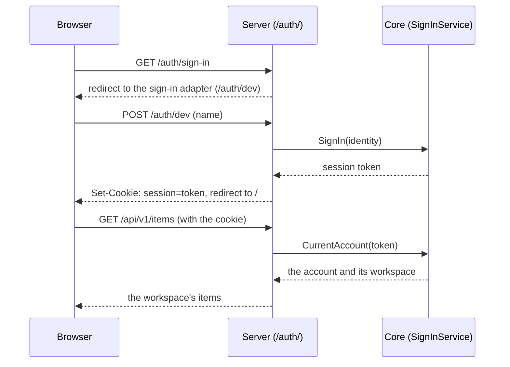
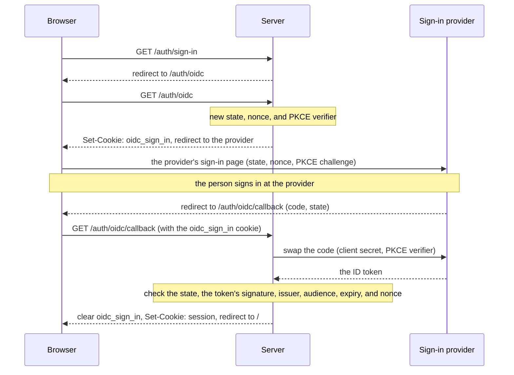
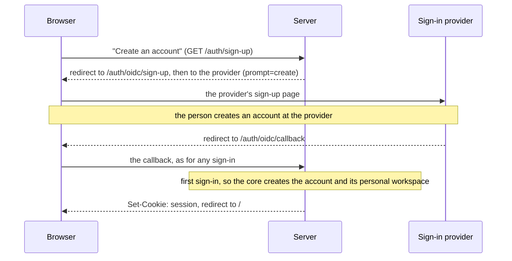
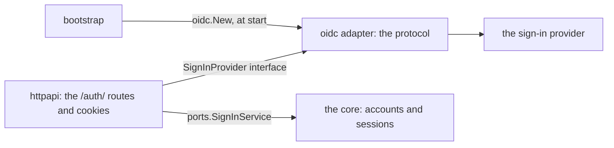
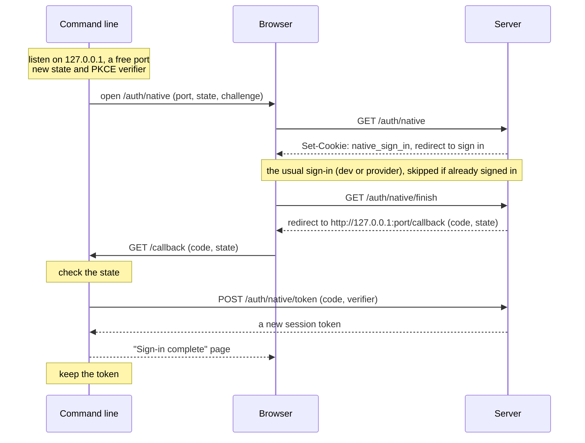
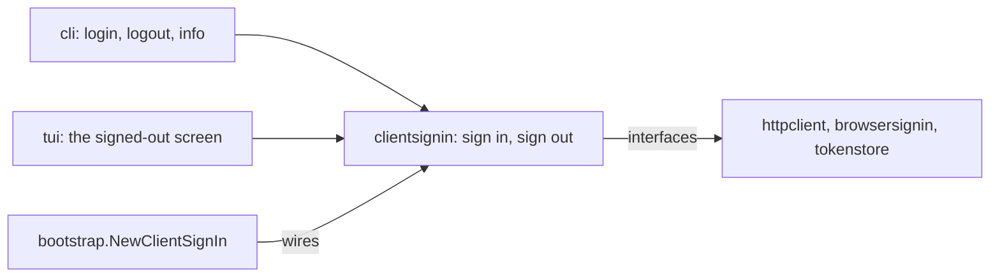

# Sign-in: accounts and sessions in the hosted edition

This guide explains how people sign in to the hosted edition, how to connect a real sign-in provider, and how to try sign-in on your own computer. The decision behind it is [ADR 9](adr/0009-sign-in-and-sessions.md), and the editions themselves are [ADR 5](adr/0005-hosted-and-local-editions.md). The business rules are in `SPEC.md` §4.18, "Sign in to the hosted edition", and §4.19, "Sign in from the command line".

The web app signs in with a cookie, which most of this guide describes. The command line and the terminal app aren't browsers, so they sign in through the browser and then send a token in a header instead. The section "Signing in from the command line and the terminal app" below explains how.

There are two ways to sign in, and a server uses one of them at a time:

- **A sign-in provider,** through [OpenID Connect (OIDC)](https://openid.net/developers/how-connect-works/). This is what a real hosted server uses. A provider is a service that checks who someone is, such as [Auth0](https://auth0.com), [Clerk](https://clerk.com), [Keycloak](https://www.keycloak.org), [Zitadel](https://zitadel.com), or Google. OIDC is the open standard that lets the server ask any of them "who is this?" in the same way. The section "Signing in through a provider" below explains it.
- **The dev sign-in,** a stand-in that signs in whoever types a name. It exists only for development and tests, and release builds leave it out.

Both are sign-in adapters behind the same seam, so everything else in this guide is the same for both.

## When sign-in is on

Sign-in is a server setting, `sign_in` (`STARTER_SIGN_IN`), and it is `off` by default.

- **With it off,** the server is the local edition, for one person hosting it for themselves. There is one workspace and no sign-in, and the web app shows no sign-in or sign-out.
- **With it `oidc`,** the server is the hosted edition, and people sign in through the sign-in provider. Each person signs in to their own account, and works in that account's personal workspace.
- **With it `dev`,** the server is the hosted edition too, with the dev sign-in in place of a provider.

The desktop and mobile apps, and the command line and the terminal app on their own data, are always the local edition. [docs/configuration.md](configuration.md) has the setting's full rules.

Sign-in keeps accounts and sessions in the app's storage, so it needs `memory`, `sqlite`, or `postgres` storage. Plain-text storage (`jsonfile`) is only for the local edition, so a program with sign-in on refuses it at start:

```
The sign-in setting is "dev", but the storage setting is "jsonfile". Sign-in needs "memory", "sqlite", or "postgres" storage. Please change the storage setting, or set the sign-in setting to "off".
```

## How it works

This is the dev sign-in's path, which is the shortest. A provider adds a trip to the provider in the middle, as the section "Signing in through a provider" shows, but the steps around it are the same.



1. **A sign-in adapter finds out who someone is.** It turns that into a `domain.Identity`, with three parts. The issuer is who vouches for the person. The subject is the issuer's ID for them, which never changes. The name is what the app shows. The dev sign-in uses the issuer `dev`, and the typed name as both the subject and the name. The OIDC adapter uses the provider's issuer and subject, as "The identity" below explains.
2. **The adapter calls the core's `ports.SignInService.SignIn`.** The first time an identity signs in, the core creates an account for it and a personal workspace. Later sign-ins find the same account by its issuer and subject, never by its name, because a name can change and two people can share one. If the identity's name has changed since the last sign-in, the core saves the new name on the account. The core returns a new session token.
3. **The server puts the token in a cookie** named `session`. The browser sends it back with every request. The web app never sees the token.
4. **The session middleware** looks the token up on every request (`CurrentAccount`), and puts the account's workspace in the request's context (`workspace.WithID`). The use cases then work in that workspace, as [docs/workspaces.md](workspaces.md) explains. The middleware reads the token from an `Authorization: Bearer <token>` header first, which is how the command line sends it, and from the cookie otherwise. A request with a bearer token that isn't valid is signed out, even if it also carries a valid cookie.
5. **Signing out** (`POST /auth/sign-out`) deletes the session from storage and clears the cookie. With a bearer token, it ends that token's session.

### Signed out means no workspace

A request with no cookie, or with a cookie whose session is unknown or expired, runs with no workspace. Every use case already refuses a request with no workspace, with `domain.ErrNoWorkspace`, before it touches storage. Over HTTP, that is a 401 problem:

```json
{"type": "no_workspace", "title": "Unauthorized", "status": 401, "detail": "Please sign in to continue."}
```

So a handler needs no sign-in check of its own. If you add a route and forget about sign-in, it still shows no data to someone signed out. This is called "failing closed".

## Signing in through a provider (OIDC)

### The words you will meet

OIDC has its own vocabulary. These are the terms this guide and the provider's settings pages use:

- **The issuer** is the provider's own address, such as `https://example.eu.auth0.com/`. The server reads the provider's settings from `<issuer>/.well-known/openid-configuration`, which is called discovery. Every token the provider gives out names its issuer, so the server can tell it came from the right provider.
- **The client ID and client secret** are a user name and password for the server itself, which the provider gives you when you register the app. The server sends them to the provider to prove that it is the app you registered. The secret must stay secret.
- **The redirect URL**, also called the callback URL, is where the provider sends the person back after they sign in. For this server it is always `<public_url>/auth/oidc/callback`. A provider sends people only to redirect URLs registered with it in advance, so another site can't pose as your app and receive their sign-in.
- **The authorization code** is a short-lived, single-use code that the provider puts in the redirect URL. The server swaps it, directly with the provider, for the tokens. The tokens never pass through the browser.
- **The ID token** is a signed statement from the provider, in the [JSON Web Token](https://jwt.io/introduction) format, that says who signed in. The server checks its signature against the provider's published keys before believing it.
- **The state** is a random value that the server puts in the request to the provider, and the provider sends back unchanged. The server signs someone in only if it gets back the state it sent. This stops another site from sending a browser to the callback with a sign-in that the browser never started. That trick is called login cross-site request forgery.
- **The nonce** ("number used once") is a random value that the server asks the provider to copy into the ID token. The server checks that the token holds the nonce of this attempt, so an ID token from an earlier sign-in can't be replayed.
- **PKCE** ("proof key for code exchange", pronounced "pixy") makes a stolen authorization code useless. The server makes up a random secret, called the verifier, for each attempt. It sends only a hash of it to the provider at the start, and the verifier itself when it swaps the code. Someone who stole the code doesn't have the verifier, so the provider won't give them the tokens. [RFC 7636](https://datatracker.ietf.org/doc/html/rfc7636) defines it.

This way of signing in is called the authorization code flow with PKCE. It is what current guidance recommends for a server like this one, which can keep a client secret.

### The redirects



1. **The web app's "Sign in" link goes to `/auth/sign-in`,** which sends the browser on to `/auth/oidc`.
2. **`/auth/oidc` starts an attempt.** It makes a fresh state, nonce, and PKCE verifier from `crypto/rand`. It keeps them in a cookie, `oidc_sign_in`, and sends the browser to the provider's sign-in page.
3. **The person signs in at the provider.** The server never sees their password, or how they proved who they are.
4. **The provider sends the browser back to `/auth/oidc/callback`,** with an authorization code and the state.
5. **The callback finishes the attempt.** It checks that the state matches the cookie's. It swaps the code with the provider, sending the client secret and the PKCE verifier. It checks the ID token: its signature, that the provider issued it, that it was meant for this app (its audience), that it hasn't expired, and that it holds the attempt's nonce.
6. **The core signs the person in,** as in "How it works" above. The server sets the `session` cookie and sends the browser to `/`.

The server asks the provider for the scopes `openid`, `profile`, and `email`. A scope is a piece of information about the person that the app asks to see.

### The attempt cookie

Between leaving for the provider and coming back, the server keeps the attempt in a cookie named `oidc_sign_in`. It holds the state and the attempt as `<state>.<attempt>`. The attempt is the nonce and the PKCE verifier, in a form that only the OIDC adapter reads. The cookie has these attributes:

| Attribute | Why |
|---|---|
| `HttpOnly` | Page scripts can't read the verifier or the nonce. |
| `SameSite=Lax` | The provider's redirect back is a top-level `GET`, which `Lax` still sends the cookie with. `Strict` would leave it off, and every sign-in would fail. |
| `Path=/auth/oidc` | The browser sends the cookie only to the OIDC routes, not with every API request. |
| `Max-Age`, 10 minutes | A person has ten minutes to finish at the provider. After that, the attempt is gone, and they start again. |
| `Secure` | The same rule as the session cookie, in "The cookie" below. |

The callback clears the cookie whatever the outcome, so an attempt is used at most once.

Keeping the attempt in a cookie, rather than in storage, means the server stores nothing for a sign-in that someone abandons. Another site can't read the cookie or set it, so it can't plant an attempt of its own.

### The identity

The OIDC adapter turns the ID token into a `domain.Identity`:

- The issuer is the token's `iss` claim. A claim is one named fact in the token.
- The subject is the token's `sub` claim, the provider's own ID for the person, which never changes.
- The name is the `name` claim. If the provider sends no name, it is the `preferred_username` claim, then the `email` claim, and then the subject, so the person always has something to be called.

No email address is stored. The account follows the provider's name: when someone changes their name at the provider, the app shows the new name from their next sign-in.

### When signing in fails

The callback refuses to sign anyone in when:

- the provider sent an `error` parameter instead of a code, such as `access_denied` when the person cancels at the provider;
- the `oidc_sign_in` cookie is missing, because the attempt expired, or the sign-in didn't start on this server;
- the state doesn't match the cookie's;
- swapping the code fails, or the ID token fails any of its checks.

The person then sees a plain page titled "Sign-in failed", with status 400 and a link to try again. The page never says what went wrong, as that could help an attacker. The server's log says it instead, as a warning:

```
time=… level=WARN msg="oidc sign-in failed" cause="the provider answered an error: access_denied"
```

### Creating an account

The web app's sign-in screen has a "Create an account" link beside "Sign in", for someone who has never used the product. It goes to `/auth/sign-up`, which sends the browser on to `/auth/oidc/sign-up`. That starts an attempt just as `/auth/oidc` does, but it asks the provider to open at its sign-up page rather than its sign-in page.

This is the journey of someone new:



The provider creates and keeps the person's account, with their email address and password. The product's own account and workspace follow at the first sign-in, as for anyone else. So there is nothing in the product that is "signing up" as such: creating an account is a sign-in that starts at a different page.

The server asks for the sign-up page with `prompt=create`, from the [OpenID Connect prompt=create](https://openid.net/specs/openid-connect-prompt-create-1_0.html) specification. Not every provider supports it, and one that doesn't may refuse the whole request. So the server sends it only when the provider's discovery lists `create` in its `prompt_values_supported`. With a provider that doesn't list it, "Create an account" opens the provider's sign-in page instead. Nearly every provider's sign-in page has its own link to sign up, so the person can still get there, with one more click.

The link always shows on the sign-in screen, even when the provider doesn't support `prompt=create`. The web app doesn't learn what the provider supports, and the link still works either way.

With the dev sign-in, `/auth/sign-up` goes to the same form as `/auth/sign-in`, since there is nowhere else to sign up.

### Signing out is local only

`POST /auth/sign-out` ends the session on this server only. The person stays signed in at the provider. So if they choose "Sign in" again, the provider may sign them straight back in without asking for their password.

OIDC has a way for the server to sign the person out at the provider too, called RP-initiated logout. The template doesn't use it. Signing someone out of their provider would also sign them out of every other app that uses it, which is rarely what they want from "Sign out" in one product. A product that needs it can add it to the sign-out route.

### Setting up a provider

1. **Choose a provider.** "Choosing a provider" below says what to look for.
2. **Register the app with it.** In the provider's dashboard, create an application of the kind it calls a "regular web application", "web app", or "confidential client". This is a server-side app that can keep a client secret, which is what this server is. Don't choose a "single-page application", even though the web app is one, because the sign-in runs on the server, not in the browser.
3. **Register the redirect URL,** `<public_url>/auth/oidc/callback`. For example, a server at `https://app.example.com` registers `https://app.example.com/auth/oidc/callback`. The provider usually calls this "Allowed callback URLs" or "Redirect URIs". It must match exactly, including `https://` and any port.
4. **Turn on sign-up at the provider,** if you want people to create their own accounts. Some providers have it off by default, or call it "registration" or "self-service sign-up". If the provider offers sign-in with email and password, turn that on too.
5. **Copy the issuer, the client ID, and the client secret** from the provider's dashboard. The issuer is sometimes shown as the "domain", the "authority", or the "OpenID configuration URL" without its `/.well-known/openid-configuration` ending.
6. **Set the server's settings.** All five are needed:

```sh
STARTER_SIGN_IN=oidc
STARTER_PUBLIC_URL=https://app.example.com
STARTER_OIDC_ISSUER=https://example.eu.auth0.com/
STARTER_OIDC_CLIENT_ID=the-client-id-from-the-provider
STARTER_OIDC_CLIENT_SECRET=the-client-secret-from-the-provider
```

[docs/configuration.md](configuration.md) describes each setting. They are server settings, so set them in the server's environment.

**Keep the client secret out of the repository.** Anyone with the secret and the client ID can pose as your app to the provider. Give it to the server through your hosting platform's secrets, such as Fly.io's [`fly secrets set`](https://fly.io/docs/flyctl/secrets-set/) or a Kubernetes [Secret](https://kubernetes.io/docs/concepts/configuration/secret/), and never in a committed file. Wherever the program lists its settings, the secret shows as `(hidden)`.

**`public_url` is the address people type,** not the one the server listens on. Behind a proxy that handles HTTPS, such as Fly.io or a load balancer, the server listens on plain HTTP on its own port, but people reach it at `https://app.example.com`. The provider must send them back to that address, so that is the `public_url`.

#### What happens when a setting is wrong

The server checks the settings when it starts, and stops with a message if any is wrong. It never starts half working.

A missing setting is named, with a hint:

```
The public_url setting is required when the sign-in setting is "oidc". Please set it to the address people reach this server at, such as https://app.example.com.
```

A `public_url` that isn't a full address is refused:

```
The public_url setting must be a full address starting with http:// or https://. Please set it to the address people reach this server at, such as https://app.example.com.
```

The server then runs discovery on the issuer. If the provider can't be reached, or doesn't answer as an OIDC provider, the server stops with this message, followed by the underlying error:

```
The sign-in provider at "https://example.eu.auth0.com/" could not be reached, or did not answer as an OpenID Connect provider. Please check that the oidc_issuer setting is the address of the sign-in provider, and that the provider is running. The error was: …
```

Discovery happens only at start. The readiness check, `/readyz`, doesn't ask the provider. So if the provider goes down while the server runs, people who are already signed in keep working, and only new sign-ins fail.

A redirect URL that isn't registered at the provider doesn't stop the server, because the server can't tell. The provider shows its own error page when someone tries to sign in. If that happens, check step 3.

### Choosing a provider

Any provider that speaks OIDC works, and the OIDC adapter has no code for any one of them. Things to weigh:

- **Who keeps the accounts.** Google, Microsoft, and GitHub are identity providers: they sign in only people who already have an account with them. Authentication services such as Auth0, Clerk, Keycloak, Zitadel, and Firebase Authentication keep their own accounts too. So with one of those, someone can sign up with only an email address and a password, on the provider's hosted sign-in page.
- **Email and password come from the provider, never from the product.** The provider stores the password hashes, and handles checking email addresses, password resets, rate limits, and two-factor sign-in. The product gets the same ID token whichever way the person signed in. So the product never builds its own password sign-in, and never stores a password. Most services can also offer "Sign in with Google" on the same page, so people get both.
- **Branding.** Most services let their hosted page carry the product's logo and colours, and its own domain, such as `auth.example.com`.
- **Whether it supports `prompt=create`,** so "Create an account" opens straight at the sign-up page. Look for `create` in `prompt_values_supported` at `<issuer>/.well-known/openid-configuration`.
- **Hosted or self-hosted.** Keycloak and Zitadel can run on your own servers, so you keep the accounts. The others run as a service, which you pay for by the number of users.

**Moving password accounts between providers is costly,** so choose carefully before people sign up. A provider keeps the password hashes, and some providers export them only on request, or not at all. Without the hashes, every user has to set a new password after a move. The person's subject also changes with the provider, and the product finds accounts by issuer and subject. So a move needs a step that matches each old account to its new identity, for example by email address, before people sign in again.

## Sessions

- **The token** is 32 random bytes from `crypto/rand` (`system.Tokens`, behind `ports.TokenGenerator`).
- **Storage keeps only the token's SHA-256 hash,** never the token. A hash can't be turned back into the token. So someone who gets a copy of the database still can't use any session in it.
- **A session lasts 30 days** from signing in (`domain.SessionLifetime`), and isn't renewed by use. An expired session counts as missing, and is deleted when someone tries to use it. Expired sessions that nobody tries to use stay in storage for now. Sweeping them away is a follow-up in the editions plan.
- **Sessions are kept in the app's storage,** beside the data. So every copy of the server on one database knows every session, and signing out ends a session everywhere at once.
- **A session is the product's own,** not the provider's. The server keeps none of the provider's tokens after the sign-in. So a session lasts its 30 days whatever the provider's tokens say, and the provider doesn't need to be up for it.

### The cookie

The cookie has these attributes. Each one is a browser feature that limits what can go wrong:

| Attribute | What it does |
|---|---|
| `HttpOnly` | Page scripts can't read the cookie. A script injected into the page, which is called cross-site scripting (XSS), can't steal the session. |
| `SameSite=Lax` | The browser leaves the cookie off most requests that other sites start, such as a form on another site that posts to this one. It still sends the cookie when someone follows a link to the app. |
| `Secure` | The browser only sends the cookie over an encrypted connection. The next paragraph says when the server sets it. |
| `Max-Age`, the session's 30 days | The cookie outlives the browser being closed, as long as the session does. |
| `Path=/` | The cookie goes with every request to the server, for the API and the `/auth/` routes alike. |

The server marks the cookie `Secure` in two cases. The first is when the request reached it over HTTPS. The second is when `public_url` starts with `https://`. The second case is for a server behind a proxy that handles HTTPS for it. The proxy talks to the server over plain HTTP, so the server can't see that the person's connection is encrypted. An `https://` public URL tells it so. The attempt cookie follows the same rule.

Don't set an `https://` public URL for a server that people reach over plain HTTP. The browser would then never send the cookie back, and nobody could stay signed in.

### Requests from other sites

With sign-in on, the server refuses any request that changes something unless it comes from the server's own pages. A request that changes something is any request except `GET`, `HEAD`, and `OPTIONS`. This protects against cross-site request forgery (CSRF), where another site makes the browser send a request that carries this site's cookie.

Go's [`http.CrossOriginProtection`](https://pkg.go.dev/net/http#CrossOriginProtection) does the check. It reads the `Sec-Fetch-Site` header, which modern browsers send with every request, or, without it, the `Origin` header. A refused request gets a 403 problem of type `cross_site`. Programs that aren't browsers, such as `curl` or the command line, send neither header, so they aren't refused. That is safe, because such a program carries no cookie that another site could ride on. The command line proves who it is with its bearer token, which no other site can make a browser send.

`SameSite=Lax` already stops most of these requests. The check closes the cases it misses, such as a page on another origin of the same site. It covers the sign-in form too, which runs before any cookie exists.

The OIDC routes are all `GET`, so this check doesn't apply to them. The state does the same job for the callback.

## The routes

Sign-in is redirects and HTML forms, not JSON, so its routes live under `/auth/`, beside the API, and not in `api/openapi.yaml`:

| Route | What it does |
|---|---|
| `GET /auth/sign-in` | Redirects to the configured sign-in adapter: `/auth/oidc`, or `/auth/dev` with the dev sign-in. The web app's "Sign in" link goes here, so it doesn't need to know which adapter is on. |
| `GET /auth/sign-up` | Redirects to `/auth/oidc/sign-up`, or `/auth/dev` with the dev sign-in. The web app's "Create an account" link goes here. |
| `GET /auth/oidc` | Starts an attempt, sets the `oidc_sign_in` cookie, and redirects to the provider's sign-in page. |
| `GET /auth/oidc/sign-up` | The same, but asks the provider for its sign-up page when it supports `prompt=create`. |
| `GET /auth/oidc/callback` | Where the provider sends the person back. Finishes the attempt, sets the session cookie, and redirects to `/`. A refused sign-in answers the "Sign-in failed" page, with status 400. |
| `GET /auth/dev` | The dev sign-in's form, which asks for a name. |
| `POST /auth/dev` | Signs in as the posted name, sets the cookie, and redirects to `/`. A blank name is a 422 `validation` problem. |
| `POST /auth/sign-out` | Ends the session, clears the cookie, and redirects to `/`. With a bearer token, it ends that token's session. |
| `GET /auth/native` | Where the command line sends the browser to sign in. It checks the loopback `port`, the `state`, and the PKCE `challenge`, keeps them in the `native_sign_in` cookie, and sends the browser to sign in, or straight to `/auth/native/finish` when it already has a session. A bad value is a 400 problem that names each one. |
| `GET /auth/native/finish` | Issues a one-time sign-in code for the browser's session, and redirects to `http://127.0.0.1:<port>/callback?code=…&state=…`. With no attempt cookie it answers 400, and with no session 401. |
| `POST /auth/native/token` | Swaps a one-time code and its PKCE verifier, sent as JSON, for a new session token, answered as JSON. A refused swap is a bare 400 that doesn't say why. |

The OIDC routes exist only with `sign_in = "oidc"`, and the dev routes only with `sign_in = "dev"`. The native routes exist with either.

The sign-in routes accept a `return` parameter, which says where to send the browser after signing in. The native sign-in uses it to come back to `/auth/native/finish`. The server follows it only when it is a path on this server, such as `/auth/native/finish`, and goes to `/` otherwise. That stops another site from using the sign-in to send people to an address of its choosing, which is called an open redirect.

The web app's service worker leaves `/auth/` alone (`navigateFallbackDenylist` in `web/vite.config.ts`), so these routes always reach the server.

The web app learns its state from `GET /api/v1/session`, which is in the OpenAPI file and always answers 200:

```json
{"isSignInOn": true, "name": "Ada"}
```

Signed out, `name` is left out, and the web app shows a sign-in screen and no data. Signed in, it shows the name and a "Sign out" button. With sign-in off, `isSignInOn` is `false`, and it shows neither.

### Where the code lives



- **`internal/adapters/oidc`** speaks the protocol, using [`go-oidc`](https://pkg.go.dev/github.com/coreos/go-oidc/v3/oidc) to check ID tokens and [`golang.org/x/oauth2`](https://pkg.go.dev/golang.org/x/oauth2) to swap the code. It has no routes or cookies. `New` runs discovery. `Start` and `StartSignUp` return the provider's URL, the state, and the attempt as a string that only `oidc` reads. `Finish` takes the attempt and the code back, and returns the identity.
- **`internal/adapters/httpapi`** owns the routes and the cookies. It defines a small `SignInProvider` interface with those three methods, in standard types only, and never imports `oidc`. So its tests use a fake that needs no provider at all.
- **`internal/bootstrap`** calls `oidc.New` with the settings, and passes the result to `httpapi`.

## The dev sign-in

The dev sign-in lets anyone sign in as anyone, so it must never reach a public server. Its wiring is behind a Go [build tag](https://pkg.go.dev/cmd/go#hdr-Build_constraints), `devsignin`, which leaves code out of a build unless the build asks for it:

- `task dev`, `task run:server`, `task run:cli`, and `task run:tui` build with the tag.
- The browser journey's server builds with it too.
- `task test:go` runs `internal/bootstrap`'s tests a second time with the tag, as the tests that need sign-in on only build with it.
- `task build`, and so every release, builds without it.

A program built without the tag refuses `sign_in = "dev"` at start:

```
The sign-in setting is "dev", but this program was built without the dev sign-in, which is only for development and tests. Please set the sign-in setting to "off", or build the program with the "devsignin" build tag.
```

Building with the tag doesn't turn sign-in on by itself. The `sign_in` setting still decides.

### Trying it

Run the development servers with sign-in on, on memory storage:

```sh
STARTER_SIGN_IN=dev STARTER_STORAGE=memory task dev
```

The web app opens signed out, with a sign-in screen. Follow "Sign in", type a name, and you're in that name's workspace. Sign out, and sign in under another name, to see that the two workspaces are apart. Memory storage forgets everything when the server restarts. Use `STARTER_STORAGE=sqlite` to keep accounts and sessions between restarts.

### Trying a real provider on your own computer

Register `http://localhost:5173/auth/oidc/callback` as a redirect URL at the provider, and use `http://localhost:5173` as the public URL. That is the address of Vite's development server, which passes `/auth/` on to the Go server. Then:

```sh
STARTER_SIGN_IN=oidc STARTER_STORAGE=sqlite \
STARTER_PUBLIC_URL=http://localhost:5173 \
STARTER_OIDC_ISSUER=https://example.eu.auth0.com/ \
STARTER_OIDC_CLIENT_ID=… STARTER_OIDC_CLIENT_SECRET=… \
task dev
```

Most providers allow `http://localhost` redirect URLs for development, but some insist on HTTPS. Use a separate registration, or a separate tenant, for development, so that its redirect URLs and test accounts stay apart from the real ones.

## Signing in from the command line and the terminal app

The command line (`starter`) and the terminal app (`starter tui`) can work on a hosted server's data, with `--server <url>`, the `STARTER_SERVER_URL` environment variable, or `server_url` in the settings file. On a server with sign-in on, they need a session too. They can't use the web app's cookie, because their requests come from the program's own Go code, not from a browser. So they sign in through the browser once, receive a session token, keep it on the computer, and send it with every request in an `Authorization: Bearer <token>` header. A bearer token is a token that grants access to whoever presents it, as a cinema ticket does.

```sh
$ starter login --server https://app.example.com
Signed in to https://app.example.com as Ada. The session token is kept in the operating system's credential store, and has a fixed lifetime for security purposes. Run starter logout to end the session before it expires.

$ starter info --server https://app.example.com
...
Signed in to https://app.example.com as Ada.
Plan: free

$ starter logout --server https://app.example.com
Signed out of https://app.example.com. The server ended the session, and the session token was removed from this computer. Run starter login to sign in again.
```

**Signing in stores a token only.** It never changes which server or data the command line uses. The server still comes from `--server`, `STARTER_SERVER_URL`, or `server_url`, and nothing writes to the settings file. So `starter login` and `starter logout` without a server are refused, and every later command needs the same server set. Signing in to a server whose sign-in is off is refused too, as there is nothing to sign in to.

### The browser and a loopback port (RFC 8252)

The command line signs in the way [RFC 8252, "OAuth 2.0 for Native Apps"](https://datatracker.ietf.org/doc/html/rfc8252) recommends for programs that run on someone's own computer. The program opens the person's usual browser, and the browser signs in exactly as it does for the web app. When it's done, the server sends the browser to a small web server that the program runs for a moment on `127.0.0.1`, the computer's own loopback address. That address can only be reached from the same computer. So the person signs in where they already are signed in, with their password manager and their provider's two-factor sign-in, and the command line never sees a password or talks to the provider.



1. **The command line listens on `127.0.0.1`,** on a free port that the operating system picks. It makes a random state and a random PKCE verifier, as the OIDC adapter does (see "The words you will meet" above).
2. **It opens the browser at the server's `/auth/native`,** with the port, the state, and the PKCE challenge, which is the SHA-256 hash of the verifier. The server checks them and keeps them for 10 minutes in a cookie, `native_sign_in`, on `Path=/auth/native`.
3. **The browser signs in as usual,** through the dev sign-in or the provider. If the browser already has a session on this server, this step is skipped.
4. **`/auth/native/finish` issues a one-time code** for the browser's account, and sends the browser to `http://127.0.0.1:<port>/callback` with the code and the state. The server builds that address itself from the port, so it never sends the browser anywhere but the loopback address.
5. **The command line checks the state.** A callback with any other state is refused, and the command line keeps waiting. This stops another page from feeding it a sign-in it didn't start.
6. **It swaps the code and its verifier** at `POST /auth/native/token`. The server checks that the verifier matches the challenge, and answers a **new session token**. This session belongs to the command line, apart from the browser's own. The browser shows a page saying that sign-in is complete, and the command line keeps the token.

**The one-time codes are kept in storage,** in the `sign_in_codes` table, through `ports.SignInCodeRepository`. As with sessions, storage keeps only the code's SHA-256 hash, with its account, its PKCE challenge, and its expiry. Keeping them in storage means that any copy of the server can redeem a code that another copy issued. A code lasts 5 minutes (`domain.SignInCodeLifetime`). It works once, because redeeming it takes it out of storage and deletes it in one step. It works only with the verifier behind its challenge. So someone who sees the code in the browser's history or address bar can't use it.

**The token is an ordinary session token.** It is looked up just as the cookie's is. It lasts 30 days from signing in, and isn't renewed by use. `starter logout` ends it on the server with `POST /auth/sign-out`, and then forgets it, even when the server can't be reached or has already ended the session.

Not chosen:
- **The device code flow** ([RFC 8628](https://datatracker.ietf.org/doc/html/rfc8628)), where the program shows a short code that the person types into a browser on any device. It suits a computer with no browser, such as one reached over SSH, and is a follow-up. The loopback address works only in a browser on the same computer as the command line, so over SSH today the person needs a browser on the remote computer.
- **Pasting a token** copied from the web app. It is clumsy, and it teaches people to copy secrets around.

### Where the token is kept

The `credential_store` setting (`STARTER_CREDENTIAL_STORE`) chooses where:

- **`system`,** the default, keeps the token in the operating system's credential store. That is the Keychain on macOS, the Credential Manager on Windows, and the Secret Service on Linux, which GNOME Keyring and KWallet provide over D-Bus. The [`zalando/go-keyring`](https://github.com/zalando/go-keyring) library talks to all three, in pure Go. The credential store encrypts the token and unlocks it with the person's login. Where there is no credential store, as on a server or in a container with no desktop session, the token goes to the file below instead, and `starter login` says so.
- **`file`** keeps the token only in `tokens.json`, in the app's folder in the user's settings folder (`~/.config/starter/tokens.json` on Linux). The file is readable only by its owner (mode `0600`). This suits CI, the terminal journeys, and people who don't want the credential store to prompt them. It also means a test never touches the developer's own credential store.

Tokens are keyed by the server's address, with its scheme and host in lower case and no trailing slash. So the command line can be signed in to several servers at once, and `https://App.example.com/` and `https://app.example.com` share one token. In the credential store, the tokens are filed under the service name `go-application-starter`, which `task rename` changes with the rest of the project's names. [docs/configuration.md](configuration.md) has the setting's full rules.

### Opening the browser

The command line opens the browser with the program that the `BROWSER` environment variable names, as `gh` and `git` do, followed by the address. `BROWSER` may carry arguments of its own, such as `BROWSER="firefox --new-window"`. With `BROWSER` unset or blank, it uses the operating system's default: `xdg-open` on Linux, `open` on macOS, and `rundll32` on Windows. Its output is discarded, so a chatty browser can't draw over the terminal app. The command line doesn't wait for the browser to close, only a moment to see whether it failed to start.

When no browser can open, the command line prints the address and keeps waiting:

```
Could not open a browser. To sign in, open this address in a browser on this computer: <address>. Waiting for you to finish signing in there. Press Ctrl+C to cancel.
```

The terminal journeys set `BROWSER` to a small script that completes the dev sign-in with `curl`, so no real browser opens in a test.

### When a session is missing or has expired

When a server refuses a request because there is no valid session, every command says to sign in, rather than showing the server's own message:

```
Error: The server at https://app.example.com refused this request, because there is no valid session for it: you are not signed in, or the session token has expired or been ended. Please run starter login to sign in, then run this command again.
```

`starter login` and `starter logout` report such a refusal as it is, since advising someone to run `starter login` while they run it would make no sense.

### The terminal app

The terminal app signs in and out by itself, and shares the command line's stored session for the server, as it is the same program. On a server with sign-in on and no session, it opens on a "Signed out" screen:

```
Signed out

Not signed in to https://app.example.com.
Sign in to see your data.

l sign in • q quit
```

- **`l` signs in.** The terminal app runs the same browser sign-in as `starter login`, and shows a "Signing in" screen with the address, in case no browser opened. Esc cancels. When the sign-in finishes, the app loads the workspace's screen on the new session, with no restart.
- **`o` signs out,** from any screen with no text input in focus. Signed in, the app shows "Signed in to <url> as <name>." above the screen, and "o sign out" in the help line.
- **A request refused mid-use** for want of a session, because the session expired or was ended elsewhere, brings back the "Signed out" screen with a note saying so.

With local data, or on a server with sign-in off, the app shows no sign-in keys and no sign-in text. Like `j` and `k`, the `l` and `o` keys work only where no text input has focus, so people can still type those letters.

### Where the code lives



- **`internal/adapters/clientsignin`** holds the steps that every client shares. `SignIn` checks that the server signs people in, runs the browser sign-in, keeps the token, and reads back who is signed in. `SignOut` ends the server's session and forgets the token. It imports no other adapter. It takes its pieces as small interfaces, which `internal/bootstrap` (`NewClientSignIn`) fills with the real ones. So its tests use fakes, and the command line and the terminal app call the same code.
- **`internal/adapters/browsersignin`** is the loopback half of the flow above: `Start` listens and opens the browser, and `Attempt.Wait` takes the callback and swaps the code. `Open` is the browser opener.
- **`internal/adapters/tokenstore`** keeps tokens: `Keyring`, `File`, and `System`, which tries the keyring and falls back to the file.
- **`internal/adapters/httpclient`** asks a token source for the token on each request (`WithTokenSource`), rather than holding a fixed token. So the terminal app picks up a new or forgotten session without reconnecting. `bootstrap.NewRemote` gives it a source that reads the server's token from the configured store.

The desktop and Android apps will sign in to a hosted server the same way, through `clientsignin`, when they gain a remote mode (step 10 of the [editions plan](plans/editions-and-accounts.md)).

## How it's tested

No test talks to a real provider. Instead, `internal/adapters/oidc/oidctest` is a fake one: a small web server started inside the test, with its own signing key, that speaks the parts of OIDC the adapter uses. It can be told to misbehave, for example to sign a token with the wrong key, or to leave `create` out of its discovery. Only tests may import it, which a depguard rule in `.golangci.yml` enforces.

- **The core:** `app.SignInService`'s unit tests cover new and returning identities, a name changed at the provider, unknown and expired tokens, and signing out, with the `testsupport` fakes for time, IDs, and tokens.
- **The OIDC adapter:** `oidc`'s tests run against `oidctest`. They cover discovery and an unreachable issuer, the authorization URL with its state, nonce, and PKCE challenge, `prompt=create`, the name's fallbacks, and every ID token check: the signature, the audience, the expiry, the issuer, and the nonce. They also cover a code the provider refuses, such as one used twice or sent with the wrong verifier.
- **Settings:** `config`'s tests cover the four OIDC settings, the messages for a missing one, and a bad `public_url`. `bootstrap`'s tests cover building the adapter and the message for an unreachable issuer.
- **Storage:** `storagetest` has contract suites for `AccountRepository` and `SessionRepository`, which memory, SQLite, and Postgres pass. jsonfile has neither.
- **The server:** `httpapi`'s tests cover the cookies, `Secure` behind an `https://` public URL, the `/auth/` routes, every cause of the "Sign-in failed" page, the 401 and 403 problems, and the session endpoint. The OIDC routes are tested with a fake `SignInProvider`.
- **Acceptance:** `features/sign-in.feature` (`@sign-in`) runs on the memory, sqlite, postgres, http, and oidc drivers. The http driver signs in through `/auth/dev`, with one cookie jar per account. The oidc driver is the hosted edition over HTTP with the real OIDC adapter against `oidctest`. It follows the redirects with a cookie jar, as a browser does. `features/sign-in-provider.feature` (`@sign-in-provider`) runs on the oidc driver only, and covers a changed name, two people with the same name, creating an account with and without `prompt=create`, cancelling at the provider, and coming back without starting. `features/workspaces.feature` also runs on http, where each workspace is a signed-in account's.
- **The command line's sign-in:** `domain` and `app` have unit tests for the codes' PKCE check, their expiry, issuing them, and redeeming them once. `storagetest` has a contract suite for `SignInCodeRepository`, which memory, SQLite, and Postgres pass. `httpapi` tests the bearer token, the native routes, and the `return` path. `browsersignin` runs against a fake server, with a fake `BROWSER` script so no real browser opens. `tokenstore` tests the keyring with go-keyring's `MockInit`, which swaps the real credential store for one in memory, and the file in a temporary folder. `clientsignin`, `cli`, and `tui` use fakes. `features/command-line-sign-in.feature` (`@command-line-sign-in`) runs on the http and oidc drivers. Its command line is the real `clientsignin` and `browsersignin` with a token store in memory, and its opener drives the harness's browser through the dev sign-in or `oidctest`. The terminal journeys in `test/terminal/features/command-line-sign-in.feature` run the built `starter` against a built server with the dev sign-in, with `STARTER_CREDENTIAL_STORE=file` and a `BROWSER` script that completes the sign-in with `curl`.
- **The browser:** `web/e2e/features/sign-in.feature` signs in with the dev sign-in, creates an account through the "Create an account" link, and signs out. It runs in its own Playwright project, against its own server with sign-in on, so the other journeys keep a server without it.

## Not built yet

- **The desktop and Android apps signing in to a hosted server (step 10).** They will reuse `clientsignin` and the native routes, as the command line does.
- **Signing in from a computer with no browser,** such as one reached over SSH, with the device code flow.
- **Roles,** such as an admin who changes plans from the web app. They wait for teams. Until then, an admin changes a plan with `starter admin set-plan`, beside the server's storage ([docs/billing.md](billing.md)).
