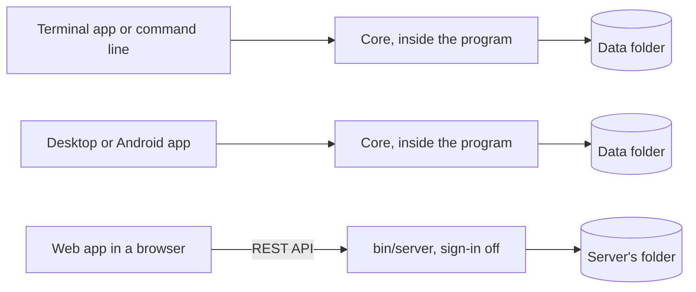
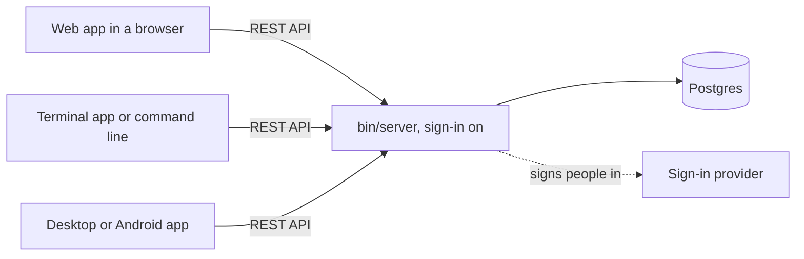

# Ways to run the app

The same app can take several forms: a desktop app, a phone app, a terminal app, or a website, on data kept on your own device or on a server. This page lists every form in one place, says who each one is for, and shows how to build and run it. The other guides go deeper, and each section links to the one it draws on.

## The two choices behind every form

Each form comes from two choices.

1. **The client** is the program the person uses. There are five: the web app in a browser, the desktop app, the Android app, the command line (CLI), and the terminal app (TUI). An iOS app is planned.
2. **The edition** decides who the data belongs to ([ADR 5](adr/0005-hosted-and-local-editions.md)).
   - In the **local edition**, one person uses the app, with no sign-in. Their data is kept in a folder on their own device, in plain-text files or a SQLite database (a database kept in a single file).
   - In the **hosted edition**, many people use one server. Each person signs in, and works in their own workspace on the server, with features and limits set by their plan.

Each copy of the app uses one edition, and nothing syncs between them. Data created in the local edition stays on that device.

## At a glance

| Form | Edition | Where the data is | Build or run it with |
|---|---|---|---|
| [Terminal app or command line on this computer's data](#terminal-app-or-command-line-on-this-computers-data) | Local | A folder on this computer | `task build` (gives `bin/starter`) |
| [Desktop app on this computer's data](#desktop-app-on-this-computers-data) | Local | A folder on this computer | `task build:desktop`, or an installer from `task package:desktop:linux` or `task package:desktop:windows` |
| [Android app on the phone's data](#android-app-on-the-phones-data) | Local | The app's private folder on the phone | `task mobile:android:build` |
| [A server for one person](#a-server-for-one-person) | Local | The server's folder | `task build` (gives `bin/server`), or `task docker:up` |
| [Web app on a hosted server](#web-app-on-a-hosted-server) | Hosted | A Postgres database behind the server | `bin/server` with sign-in on, deployed by `deploy.yml` |
| [Terminal app or command line on a hosted server](#terminal-app-or-command-line-on-a-hosted-server) | Hosted | On the server | `bin/starter` with `--server` |
| [Desktop or Android app on a hosted server](#desktop-or-android-app-on-a-hosted-server) | Hosted | On the server | `BUILT_IN_SERVER_URL=… task build:desktop`, or the same for `task mobile:android:build` |

## How the parts fit together

In the local edition, each client carries the whole app inside it. The core is the part that holds the business rules, and the client calls it directly, inside the same program. Nothing goes over a network.



In the hosted edition, every client reaches one server over its REST API, and only the server touches the database. The desktop and Android apps still show the same web app in their window. Their window talks to a handler inside the app, and the handler passes each request on to the server.



## The local edition

### Terminal app or command line on this computer's data

For someone who works in a terminal and keeps their data on their own computer.

```sh
task build            # builds bin/starter (and bin/server)
./bin/starter --help  # the command line
./bin/starter tui     # the terminal app
```

While developing, `task run:cli -- --help` and `task run:tui` run them without building first.

They keep their data in the same folder as the desktop app, which is `~/.config/starter` on Linux and `%AppData%\starter` on Windows. `starter info` prints the folder. With plain-text storage, only one program can use the folder at a time, so the terminal programs refuse to start while the desktop app is open. SQLite storage lets them share it. [docs/data-locations.md](data-locations.md) covers every case, and [docs/configuration.md](configuration.md) covers the `storage` and `data_dir` settings.

### Desktop app on this computer's data

For someone who wants a normal app in a window, with their data on their own computer.

```sh
task run:desktop                # run it while developing
task build:desktop              # build it into bin/
task package:desktop:linux      # the .deb, .rpm, and AppImage installers
task package:desktop:windows    # the Windows setup program
```

The desktop app needs some system libraries to build, which the README's Prerequisites list. It's built with [Wails](https://wails.io), which puts the web app in a native window, with the core running in the same program ([ADR 4](adr/0004-native-shells.md)). A macOS installer is planned.

### Android app on the phone's data

For someone who wants the app on their phone, with the data kept on the phone.

```sh
task mobile:android:run     # build it, install it on the emulator or a connected phone, and open it
task mobile:android:build   # build bin/starter.apk
```

It needs the Android tools, which [docs/mobile.md](mobile.md) explains how to set up. Its data is kept in plain-text files in the app's private folder, which no other app can read.

### A server for one person

For someone who wants to reach their own data from a browser, or from several of their devices, by running the server themselves. With sign-in off, the server is the local edition: one workspace, and no sign-in.

```sh
task build && ./bin/server   # the server and web app on http://localhost:8080
task docker:up               # the same, in a Docker container
```

The web app is built into the server, so opening the address in a browser shows it. The terminal programs can use the same data with `--server http://localhost:8080`, and the desktop app can with the `server_url` setting. The server keeps its data in `./data`, relative to the folder it was started in.

Because there is no sign-in, anyone who can reach the server can see and change the data. Keep it on a network you trust.

## The hosted edition

Teams aren't built yet. Each person who signs in works in a workspace of their own, and can't share it with anyone else. Teams with members and roles are on the backlog in `TODO.md`.

### Web app on a hosted server

For a product sold or offered to many people. Each person opens the website, signs in, and works in their own workspace.

The server runs with sign-in on and Postgres storage. Sign-in goes through a sign-in provider such as Auth0 or Keycloak, using OpenID Connect (OIDC), a standard way for a website to let another service sign people in.

```sh
STARTER_SIGN_IN=oidc STARTER_STORAGE=postgres \
STARTER_DATABASE_URL=… STARTER_PUBLIC_URL=https://app.example.com \
STARTER_OIDC_ISSUER=… STARTER_OIDC_CLIENT_ID=… STARTER_OIDC_CLIENT_SECRET=… \
./bin/server
```

`deploy.yml` deploys the server to [Fly.io](https://fly.io), and the README's "One-time Fly.io setup" explains how to set it up. [docs/sign-in.md](sign-in.md) explains choosing and setting up a provider. [docs/features.md](features.md) and [docs/billing.md](billing.md) explain plans and payments.

### Terminal app or command line on a hosted server

For someone with an account on the hosted product who prefers the terminal. They sign in once, through their browser, and the session is kept in the operating system's credential store.

```sh
./bin/starter --server https://app.example.com login
./bin/starter --server https://app.example.com tui
```

Setting `STARTER_SERVER_URL`, or `server_url` in the settings file, saves typing `--server` each time. [docs/sign-in.md](sign-in.md), "Signing in from the command line and the terminal app", explains how the sign-in works.

### Desktop or Android app on a hosted server

For someone with an account on the hosted product who wants it as an app, on their computer or phone. This is called remote mode. The app keeps no data of its own, shows a notice when it's offline, and signs in through the system browser.

```sh
BUILT_IN_SERVER_URL=https://app.example.com task build:desktop
BUILT_IN_SERVER_URL=https://app.example.com task mobile:android:build
```

An app built with an address always opens on that server, and has no local mode. A desktop app built without one goes into remote mode when the `server_url` setting or `STARTER_SERVER_URL` is set. The Android app has no settings file people can edit, so it needs the built-in address. [docs/configuration.md](configuration.md), "A server address built into the program", and [docs/sign-in.md](sign-in.md), "Signing in from the desktop and mobile apps", explain more.

## While developing

These are the setups for working on the app itself. They aren't forms a user would run.

| To work on | Run | Notes |
|---|---|---|
| The web app, local edition | `task dev` | The server on :8080 and the web app on :5173, opened in your browser, both reloading on changes. |
| The web app, hosted edition | `STARTER_SIGN_IN=dev STARTER_STORAGE=memory task dev` | The dev sign-in signs in whoever types a name, so no provider is needed. Memory storage forgets everything when the server stops. |
| The desktop app, CLI, or TUI on a hosted server | `task dev:server:signin`, then `STARTER_SERVER_URL=http://localhost:8080 task run:desktop` (or `task run:cli -- --server http://localhost:8080 login`) | A server with the dev sign-in, for the other clients to sign in to. |
| The Android app on a hosted server | `task dev:server:signin`, then `BUILT_IN_SERVER_URL=http://<this computer's address>:8080 task mobile:android:run` | The phone or emulator must be able to reach the address. On the emulator, `10.0.2.2` is the computer it runs on. |

[docs/sign-in.md](sign-in.md), "The dev sign-in", explains the dev sign-in, and why it's only in development builds.
